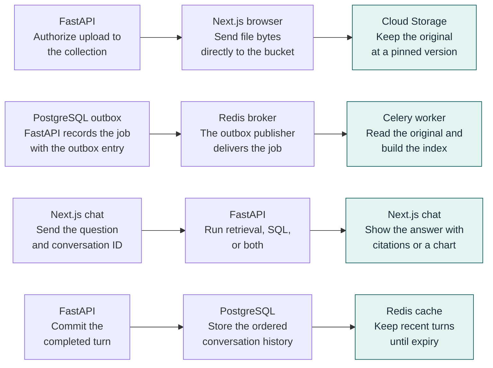
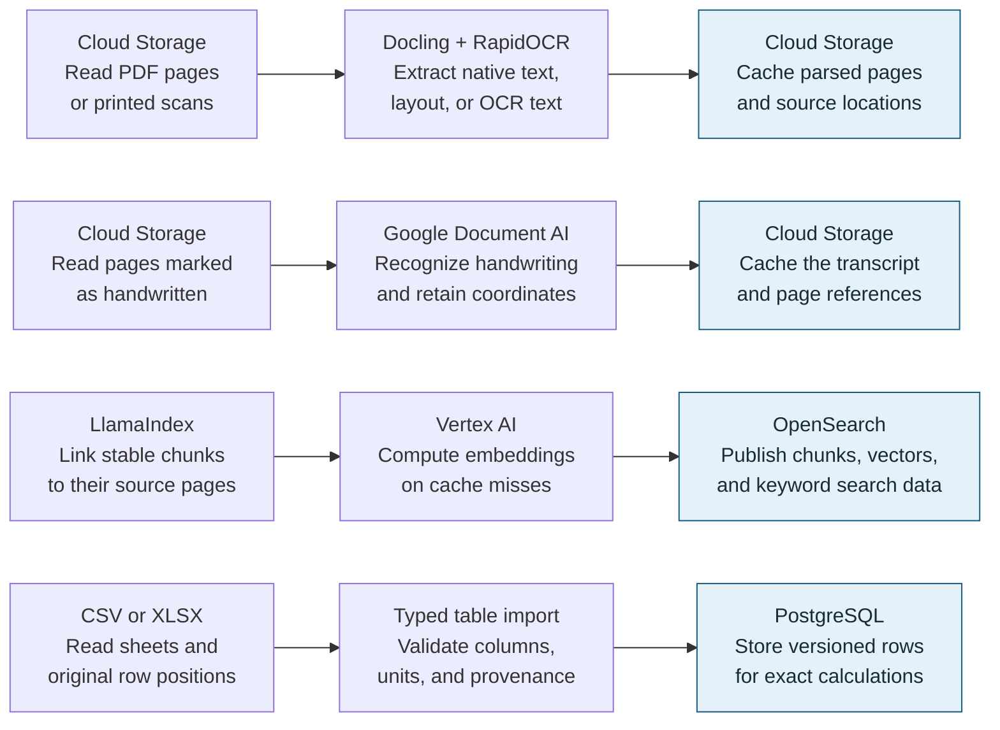
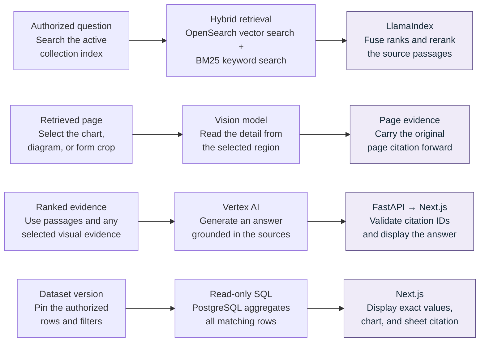
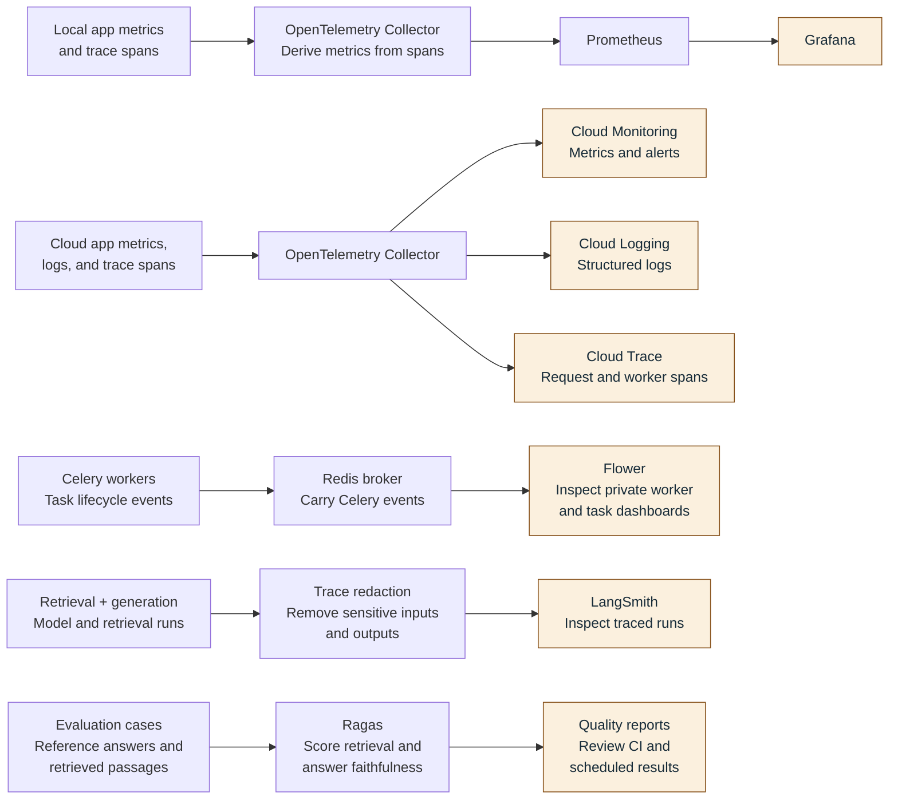
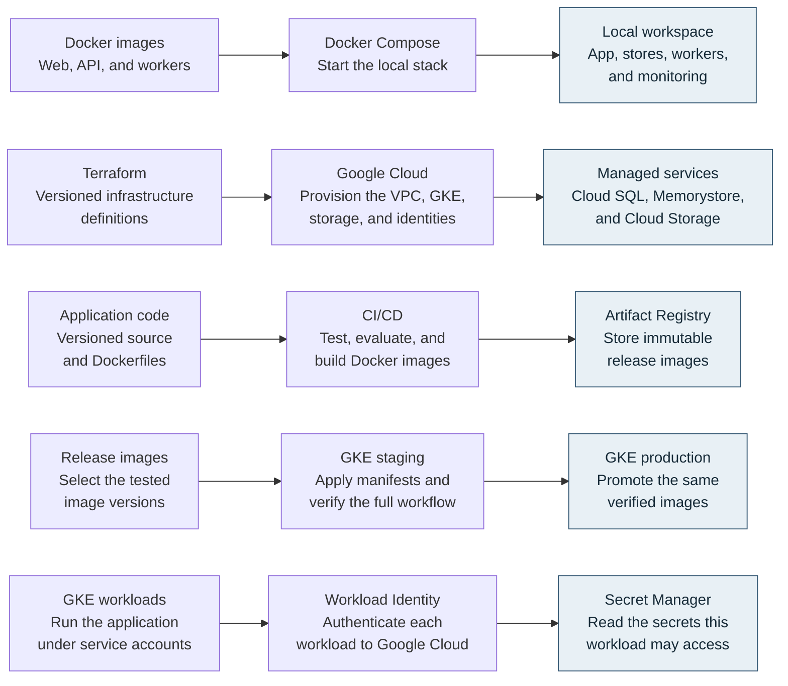

# Document intelligence workspace

A planned Google Cloud application for asking questions across private files and calculating results from spreadsheets. Document answers link to source pages. Calculations link to the dataset version, sheet, and rows behind each number.

Read each diagram one row at a time, from left to right. Each row follows one operation or signal.

## System map

The browser uploads new files directly to Cloud Storage after FastAPI authorizes the destination. Reingestion starts from a stored document ID. On a Redis cache miss, FastAPI reloads the authorized conversation from PostgreSQL.

Editable Mermaid flow

## How a file becomes searchable

Celery runs these paths. Printed and handwritten extraction feed the indexing row. LlamaIndex also indexes spreadsheet descriptions for discovery. A worker claims each missing artifact in PostgreSQL before requesting paid processing. Reingestion reuses completed OCR, enrichment, and embeddings. Generated chunk questions are the first enrichment experiment. A change to the embedding model triggers a collection-wide index migration.

## How a question becomes an answer

FastAPI checks collection and conversation access before querying. Vertex AI embeds the question for OpenSearch vector search. For a mixed question it calculates first, then uses the result to find explanatory passages. For visual questions it can send a retrieved page or crop to a vision model. ColPali is a retrieval experiment if visual pages regularly miss the candidate set.

## Monitoring and evaluation

With `APP_MODE=local`, Grafana reads application metrics and metrics derived from trace spans from Prometheus. With `APP_MODE=cloud`, OpenTelemetry exports metrics to Cloud Monitoring, logs to Cloud Logging, and spans to Cloud Trace. Trace IDs correlate cloud logs and spans. Ragas runs in CI and on a schedule.

## From local development to Google Cloud

Kubernetes manifests deploy Next.js, FastAPI, Celery, the outbox publisher, and operational services. Cloud SQL hosts PostgreSQL. A private OpenSearch workload on GKE serves vector and keyword queries. Memorystore provides separate Redis broker and cache capacity. Workload Identity gives services access to Cloud Storage and Secret Manager. Later source integrations include URLs, Google Drive, OneDrive, and SharePoint.

Editable Mermaid flow

[Architecture and API contracts](docs/architecture.md) · [Implementation milestones and acceptance checks](docs/plan.md)
