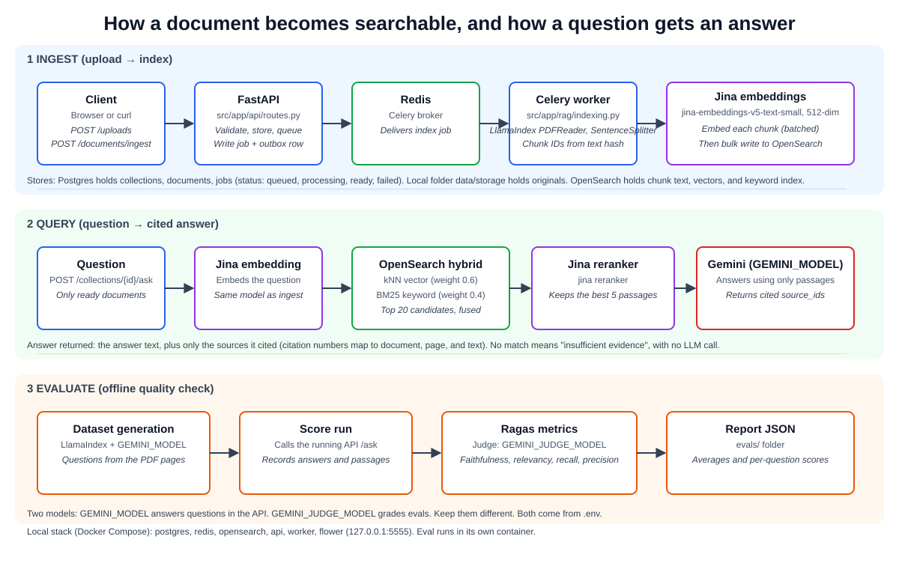

# Private document workspace

Upload PDFs, then ask questions about them. Each answer cites the document pages it used.

> Status: milestone 1 (ingest and question answering over PDFs). Browser UI, spreadsheets, and cloud deployment are not built yet. See [docs/plan.md](docs/plan.md).

## Architecture



- **Ingest:** the API stores the file and queues a job in Redis. A Celery worker extracts text, splits it into chunks, embeds each chunk with Jina, and writes the chunks to OpenSearch.
- **Query:** the question is embedded and searched in OpenSearch (vector plus keyword). Jina reranks the results, and Gemini answers using only those passages.
- **Evaluate:** an offline script builds questions from a PDF, calls the running API, and scores the answers with Ragas.

Details: [docs/architecture.md](docs/architecture.md).

## Prerequisites

- Docker and Docker Compose
- A Jina API key and a Gemini API key
- On Linux or WSL, set the host setting OpenSearch needs:

```bash
sudo sysctl -w vm.max_map_count=262144
```

## 1. Set up

```bash
make env
```

This creates `.env` from `.env.example`. Open `.env` and set:

| Variable | Purpose |
|---|---|
| `POSTGRES_PASSWORD` | Database password (any value you choose) |
| `JINA_API_KEY` | Embeddings and reranking |
| `GEMINI_API_KEY` | Answer generation and evaluation judge |
| `GEMINI_MODEL` | Model that answers questions |
| `GEMINI_JUDGE_MODEL` | Model that grades evaluations. Keep it different from `GEMINI_MODEL`. |

Never commit `.env`.

## 2. Start the stack

```bash
make up
```

Wait until the containers are healthy (`docker compose -f ops/compose.yaml ps`). This starts Postgres, Redis, OpenSearch, the API, the Celery worker, and Flower.

| Service | Address |
|---|---|
| Web app (upload and ingest) | http://127.0.0.1:3000 |
| API | http://127.0.0.1:8000 |
| Flower (task dashboard) | http://127.0.0.1:5555 |
| pgAdmin (Postgres GUI) | http://127.0.0.1:5050 |
| RedisInsight (Redis GUI) | http://127.0.0.1:5540 |

Postgres and Redis have no web page. Open them with a GUI tool or client:

| Service | Host | Port | Database or user |
|---|---|---|---|
| Postgres | 127.0.0.1 | 5432 | database `rag`, user `rag`, password `POSTGRES_PASSWORD` from `.env` |
| Redis | 127.0.0.1 | 6379 | database `0`, no password |

To connect in pgAdmin, add a server with host `postgres` (the name inside Docker, not `127.0.0.1`), port `5432`, database `rag`, and user `rag`. pgAdmin's login is `PGADMIN_DEFAULT_EMAIL` and `PGADMIN_DEFAULT_PASSWORD` from `.env`. In RedisInsight, add a database with host `redis` and port `6379`.

Check the API:

```bash
curl http://127.0.0.1:8000/health
```

Expected: a JSON response with `"status": "ok"`.

## 3. Ingest a PDF

```bash
make demo-ingest PDF=docs/demo-docs/Transformer_Theory_Notes.pdf
```

The script uploads the file, queues indexing, and waits. Expected output ends with `is ready`.

To check one document:

```bash
make document-status DOCUMENT_ID=<document UUID>
```

Status moves through `queued`, `processing`, then `ready` or `failed`. Only `ready` documents are searched.

## 4. Ask a question

```bash
make demo-ask QUERY="What is deep learning?" TOP_K=5
```

The response has an `answer` and a `sources` list. Each source has a citation number, the document, the page, and the passage text. If the documents do not contain the answer, the response says so.

Search without an LLM answer:

```bash
make demo-search QUERY="neurons pass information"
```

By default the question runs against the demo collection. Override with `COLLECTION_ID=<uuid>`.

## 5. Evaluate answer quality (optional)

This calls paid Gemini and Jina APIs. The API must be running (step 2).

```bash
make eval-dataset EVAL_PDF="Transformer_Theory_Notes.pdf"
make eval-run
```

1. `eval-dataset` builds questions from the PDF pages and saves them to `evals/`.
2. `eval-run` asks each question through the API and scores the answers. The report is written to `evals/`.

Use `EVAL_LIMIT=5` to score only five questions while you test.

## 6. Logs and troubleshooting

```bash
make logs          # API and worker logs (JSON lines)
make down          # stop the stack
```

| Symptom | Likely cause |
|---|---|
| `POSTGRES_PASSWORD` error on `make up` | `.env` is missing the value |
| OpenSearch container exits | Run the `vm.max_map_count` command in Prerequisites |
| Document stays `queued` | Worker is not running. Check `make logs`. |
| Document shows `failed` | Read the worker logs. The database keeps only a safe message. |
| `/ask` returns 503 | Gemini or Jina key is missing or invalid, or the service is down |

## Development

```bash
make check         # lint and tests for the API, run in Docker
```

- API code: `src/app/`. Routes in `api/routes.py`, models in `schema/models.py`, settings in `config/`.
- Tests: `src/tests/`. Tests use mocks and never call real services.
- Database migrations: `src/app/db/migrations/`. Applied migrations are not edited.
- Evaluation script: `ops/rag_eval.py`.

Project rules are in [CLAUDE.md](CLAUDE.md). Change history is in [CHANGELOG.md](CHANGELOG.md).
